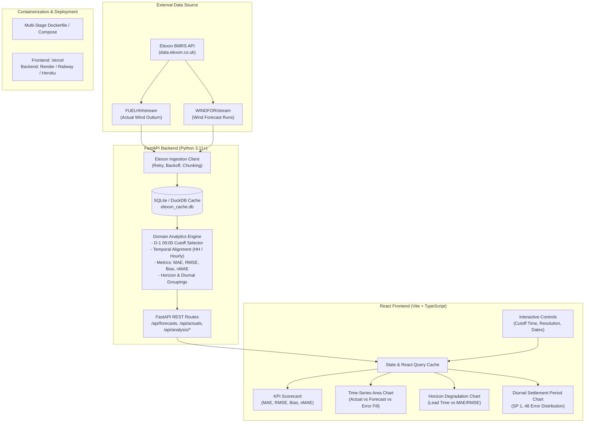

# Implementation Plan: UK Day-Ahead Wind Forecast & Actuals Analytics Platform

## 1. Goal Restatement
1. A UK energy utility wholesale power buyer must procure electricity on day-ahead markets to balance consumer demand against intermittent renewable generation.
2. Because day-ahead auction order books close one day prior to delivery (day D-1), thermal and market procurement decisions depend directly on wind forecast accuracy.
3. This web application enables the buyer to inspect the exact latest national wind generation forecasts available at their decision cutoff time (default: 09:00 UK time on D-1).
4. It reconciles these decision-time forecasts against Elexon BMRS outturn generation (`FUELHH`) across January 2026 at half-hourly settlement resolution.
5. By delivering rigorous error quantification (MAE, RMSE, bias, horizon decay, diurnal profiles), the tool empowers traders to adjust imbalance buffers and minimize costly cash-out exposure.

---

## 2. Key Domain Decisions & Assumptions

### 2.1 Latest Available Forecast & Decision Cutoff Logic
* **GB Day-Ahead Market Context**: In Great Britain (GB), wholesale day-ahead power auction order books (e.g., EPEX SPOT GB Day-Ahead Auction and Nord Pool GB Day-Ahead Auction) close during the morning of day $D-1$ (typically 09:20–09:50 UK local time), with utility dispatch and procurement desks finalizing their bidding bids around 09:00.
* **Configurable Decision Cutoff**:
  * Default cutoff: **09:00 UK local time (Europe/London) on Day $D-1$** for delivery across all 48 half-hour settlement periods of delivery day $D$.
  * The cutoff time must be configurable via the API and UI (e.g., 08:00, 09:00, 10:00, or 11:00) to allow traders to evaluate the economic value of delaying decisions or using fresher forecast runs.
* **Selection Algorithm**:
  1. For each target delivery half-hour $t$ occurring on date $D$ (where $t \in [D\text{ 00:00}, D\text{ 23:30}]$):
  2. Compute the exact cutoff threshold: $T_{\text{cutoff}}(D) = (D - 1\text{ day}) \text{ at } \text{cutoff\_time}$ (e.g., for target delivery day `2026-01-02`, $T_{\text{cutoff}} = \text{2026-01-01 09:00:00 GMT}$).
  3. Filter the `WINDFOR` dataset to all forecast publications satisfying:
     $$\text{publishTime} \le T_{\text{cutoff}}(D)$$
  4. From these eligible forecast runs, select the record for target $t$ associated with the maximum `publishTime`:
     $$\text{publishTime}^* = \max \{ \text{publishTime} \mid \text{publishTime} \le T_{\text{cutoff}}(D) \land \text{run covers } t \}$$
  5. *Empirical Verification*: Elexon `WINDFOR` runs are published roughly every 2 to 4 hours (e.g., `02:30`, `04:30`, `07:30`, `09:30 UTC`) with a forecast horizon extending 72+ hours into the future. At `09:00 GMT` on day $D-1$, the latest available published run is typically the `07:30 GMT` run, which completely spans all 48 settlement periods of delivery day $D$. If the `07:30` run is delayed or missing, the algorithm automatically falls back to the preceding valid run (e.g., `04:30 GMT`).

---

### 2.2 Aligning WINDFOR and FUELHH on startTime (UTC vs UK Local Time & Resolution)

#### A. Timezone Alignment (UTC vs Europe/London)
* **Dataset Characteristics**: Both `FUELHH` and `WINDFOR` from Elexon BMRS provide ISO 8601 timestamps in UTC (`YYYY-MM-DDTHH:MM:SSZ`).
* **January 2026 Specifics**: In January, Great Britain is on Greenwich Mean Time (GMT, UTC+00:00). UTC timestamps match UK local clock time.
* **Balancing and Settlement Code (BSC) Compatibility**: GB power trading operates on **Settlement Date** and **Settlement Period** ($SP \in [1, 48]$).
  * SP 1 = 00:00 to 00:30 UK local time
  * SP 2 = 00:30 to 01:00 UK local time
  * ...
  * SP 48 = 23:30 to 24:00 UK local time
* **Architecture Decision**:
  * Store and index all data internally in **UTC** as canonical timestamps.
  * Enrich each record with `settlementDate` and `settlementPeriod` (derived via `Europe/London` zoneinfo) to support seasonal clock-change safety (BST/GMT) and GB market convention.
  * Render timestamps in UK local time on the user dashboard.

#### B. Granularity Alignment (Half-Hourly Actuals vs Hourly Forecasts)
* **Dataset Granularity**:
  * `FUELHH` (Actuals): Published every **30 minutes** (half-hourly, 48 periods/day), giving average power generated in MW per half-hour.
  * `WINDFOR` (Forecasts): Published at **hourly** intervals (`:00:00Z`, 24 points/day), giving expected generation in MW over that hour.
* **Resolution Alignment Strategy**:
  1. **Primary Model (Half-Hourly Step Interpolation / Forward Fill)**:
     In power markets, the hourly forecast for hour $[H, H+1)$ represents the expected continuous average power across that 60-minute interval. Since day-ahead power contracts trade in half-hourly settlement periods, the standard trading desk assumption assigns the hourly forecast to both constituent settlement periods:
     $$\hat{y}_{H:00} = \text{Forecast}_H \quad (SP_{2H+1})$$
     $$\hat{y}_{H:30} = \text{Forecast}_H \quad (SP_{2H+2})$$
     This preserves the exact half-hourly settlement granularity expected by power buyers.
  2. **Secondary Model (Hourly Outturn Aggregation Toggle)**:
     To evaluate forecast performance on native hourly terms, the system also provides an hourly aggregation mode:
     $$y_{H} = \frac{y_{H:00} + y_{H:30}}{2}$$
     Both views will be supported via an API parameter (`resolution=half_hourly` or `resolution=hourly`).

---

### 2.3 Error Metrics & Horizon Analysis
Let:
* $y_t$: Actual wind generation (MW) from `FUELHH` for period $t$.
* $\hat{y}_t$: Decision-cutoff wind forecast (MW) from `WINDFOR` for period $t$.
* $e_t = \hat{y}_t - y_t$: Forecast error for period $t$.

#### Sign Convention & Market Interpretation
* **Positive Error ($e_t > 0$, Over-forecast)**: Forecast was higher than actual generation. The buyer relied on wind that failed to materialize. The utility was left **short**, forced to buy deficit energy at the potentially punitive System Buy Price (SBP) or activate costly peaker plants.
* **Negative Error ($e_t < 0$, Under-forecast)**: Forecast was lower than actual generation. The buyer over-procured thermal power. The utility was left **long**, spilling energy into the balancing mechanism at the System Sell Price (SSP).

#### Quantitative Metrics
1. **Mean Absolute Error (MAE)**:
   $$\text{MAE} = \frac{1}{N} \sum_{t=1}^N |\hat{y}_t - y_t| \quad \text{[MW]}$$
   Measures the average unhedged volume exposure per settlement period.
2. **Root Mean Square Error (RMSE)**:
   $$\text{RMSE} = \sqrt{\frac{1}{N} \sum_{t=1}^N (\hat{y}_t - y_t)^2} \quad \text{[MW]}$$
   Penalizes large outlier forecast errors that threaten grid balance and create outsized financial losses.
3. **Bias (Mean Error)**:
   $$\text{Bias} = \frac{1}{N} \sum_{t=1}^N (\hat{y}_t - y_t) \quad \text{[MW]}$$
   Identifies systematic over-forecasting ($\text{Bias} > 0$) or under-forecasting ($\text{Bias} < 0$).
4. **Normalized Mean Absolute Error (nMAE)**:
   $$\text{nMAE} = \frac{\text{MAE}}{\bar{y}} \times 100\% \quad \text{where } \bar{y} = \frac{1}{N}\sum_{t=1}^N y_t$$
   Standard wind industry metric that contextualizes error against average monthly generation.
5. **Thresholded MAPE**:
   Standard MAPE explodes towards infinity when actual generation approaches zero. Therefore, standard percentage error is calculated conditionally for periods where $y_t \ge 100\text{ MW}$:
   $$\text{MAPE}_{>100\text{MW}} = \frac{1}{M} \sum_{t: y_t \ge 100\text{MW}} \frac{|\hat{y}_t - y_t|}{y_t} \times 100\%$$
6. **Error by Forecast Horizon (Forecast Degradation Curve)**:
   * Define lead time horizon: $h = (\text{startTime}_t - \text{publishTime}) \text{ in hours}$.
   * For day-ahead cutoff at D-1 09:00, horizons for day D range from **15 hours** (period 00:00) to **39 hours** (period 23:30).
   * Evaluate MAE, RMSE, and Bias grouped by horizon bins ($h \in [1, 4], [5, 8], \dots, [37, 48]$) to demonstrate how forecast accuracy degrades as lead time increases.
7. **Diurnal Settlement Period Error Profile**:
   * Error statistics aggregated by Settlement Period ($SP \in [1, 48]$) to highlight whether forecast skill drops during high-demand morning/evening ramp hours.

---

## 3. Architecture



### Components
1. **Backend (FastAPI + Python 3.11+)**:
   * High-performance asynchronous REST API.
   * Resilient ingestion service for Elexon BMRS datasets with automatic chunking and rate-limit backoff.
   * Persistent local SQLite database (`elexon_cache.db`) indexing raw outturns and forecast runs. Ensures sub-15ms response times and zero external API dependencies during demo / evaluation.
   * Domain analytics service implementing cutoff filtering, temporal alignment, and vectorized metric computations.
2. **Frontend (React 18 + Vite + TypeScript + Tailwind CSS)**:
   * Professional dark/light trading desk UI designed for energy market analysts.
   * Interactive filters: Cutoff time picker (default `09:00`), date range selector, resolution switch (`Half-Hourly` vs `Hourly`).
   * Rich interactive visualizations using `Recharts`:
     * Dual-axis actual vs forecast generation profile with delta fill.
     * Forecast horizon decay curve (MAE/RMSE vs lead time in hours).
     * Diurnal settlement period box/bar chart showing peak vs off-peak volatility.
     * Summary KPI cards with color-coded bias direction and percentage error.
3. **Docker**:
   * Multi-stage build containerizing backend and frontend.
   * Single-command local startup via `docker compose up --build`.
   * Option for unified single-container deployment (FastAPI serving Vite production static assets) to ensure zero CORS issues on cloud hosts.
4. **Deploy Target**:
   * Frontend: **Vercel** (fast edge CDN delivery).
   * Backend: **Render** / **Railway** / **Heroku** (Python web service with SQLite volume or pre-seeded cache).

---

## 4. API Endpoints List with Request/Response Shapes

### 4.1 `GET /api/health`
Health check and local cache status.
* **Response**:
```json
{
  "status": "healthy",
  "version": "1.0.0",
  "cache": {
    "fuelhh_records": 1488,
    "windfor_records": 18240,
    "date_range": {
      "start": "2026-01-01T00:00:00Z",
      "end": "2026-01-31T23:30:00Z"
    }
  }
}
```

---

### 4.2 `GET /api/forecasts/cutoff`
Returns latest available wind forecast for each target period based on the decision cutoff.
* **Query Parameters**:
  * `start_date` (optional, default `"2026-01-01"`): Target start date (YYYY-MM-DD).
  * `end_date` (optional, default `"2026-01-31"`): Target end date (YYYY-MM-DD).
  * `cutoff_time` (optional, default `"09:00"`): Decision cutoff in UK local time (HH:MM).
  * `cutoff_day_offset` (optional, default `1`): Days prior to delivery (1 = Day D-1).
  * `resolution` (optional, default `"half_hourly"`): `"half_hourly"` | `"hourly"`.
* **Response**:
```json
{
  "metadata": {
    "cutoff_time": "09:00",
    "cutoff_day_offset": 1,
    "resolution": "half_hourly",
    "total_records": 1488
  },
  "data": [
    {
      "startTime": "2026-01-02T00:00:00Z",
      "settlementDate": "2026-01-02",
      "settlementPeriod": 1,
      "publishTime": "2026-01-01T07:30:00Z",
      "forecastGeneration": 18767.0,
      "horizonHours": 16.5
    },
    {
      "startTime": "2026-01-02T00:30:00Z",
      "settlementDate": "2026-01-02",
      "settlementPeriod": 2,
      "publishTime": "2026-01-01T07:30:00Z",
      "forecastGeneration": 18767.0,
      "horizonHours": 17.0
    }
  ]
}
```

---

### 4.3 `GET /api/actuals`
Returns outturn actual wind generation from `FUELHH`.
* **Query Parameters**:
  * `start_date` (optional, default `"2026-01-01"`): YYYY-MM-DD.
  * `end_date` (optional, default `"2026-01-31"`): YYYY-MM-DD.
  * `resolution` (optional, default `"half_hourly"`): `"half_hourly"` | `"hourly"`.
* **Response**:
```json
{
  "metadata": {
    "fuelType": "WIND",
    "resolution": "half_hourly",
    "total_records": 1488
  },
  "data": [
    {
      "startTime": "2026-01-02T00:00:00Z",
      "settlementDate": "2026-01-02",
      "settlementPeriod": 1,
      "actualGeneration": 17450.0
    }
  ]
}
```

---

### 4.4 `GET /api/analysis/comparison`
Returns time-series joining actual outturn and cutoff forecast with calculated delta.
* **Query Parameters**: Same as `/api/forecasts/cutoff`.
* **Response**:
```json
{
  "metadata": {
    "cutoff_time": "09:00",
    "resolution": "half_hourly"
  },
  "series": [
    {
      "startTime": "2026-01-02T00:00:00Z",
      "settlementDate": "2026-01-02",
      "settlementPeriod": 1,
      "publishTime": "2026-01-01T07:30:00Z",
      "forecastGeneration": 18767.0,
      "actualGeneration": 17450.0,
      "error": 1317.0,
      "absoluteError": 1317.0,
      "percentageError": 7.55,
      "horizonHours": 16.5
    }
  ]
}
```

---

### 4.5 `GET /api/analysis/metrics`
Returns summary performance metrics across the selected window.
* **Query Parameters**: `start_date`, `end_date`, `cutoff_time`, `resolution`.
* **Response**:
```json
{
  "summary": {
    "sampleCount": 1488,
    "totalActualEnergyMWh": 7450120.0,
    "totalForecastEnergyMWh": 7610400.0,
    "meanActualMW": 10013.6,
    "meanForecastMW": 10229.0
  },
  "metrics": {
    "mae": 1142.35,
    "rmse": 1528.80,
    "bias": 215.40,
    "nmae": 11.41,
    "mapeThresholded": 12.85,
    "maxUnderforecastMW": -3890.0,
    "maxOverforecastMW": 4210.0,
    "p90AbsoluteError": 2450.0,
    "p95AbsoluteError": 3120.0
  }
}
```

---

### 4.6 `GET /api/analysis/by-horizon`
Returns error metrics aggregated by lead-time horizon (hours between publication and settlement).
* **Query Parameters**: `start_date`, `end_date`, `step_hours` (default `4`).
* **Response**:
```json
{
  "data": [
    {
      "horizonBin": "16-20h",
      "horizonMin": 16,
      "horizonMax": 20,
      "sampleCount": 248,
      "mae": 980.5,
      "rmse": 1240.2,
      "bias": 110.4
    },
    {
      "horizonBin": "36-40h",
      "horizonMin": 36,
      "horizonMax": 40,
      "sampleCount": 248,
      "mae": 1450.8,
      "rmse": 1890.6,
      "bias": 320.1
    }
  ]
}
```

---

### 4.7 `GET /api/analysis/by-settlement-period`
Returns error breakdown across GB Settlement Periods (1 to 48) to reveal diurnal profiling.
* **Query Parameters**: `start_date`, `end_date`, `cutoff_time`.
* **Response**:
```json
{
  "data": [
    {
      "settlementPeriod": 1,
      "timeLabel": "00:00 - 00:30",
      "mae": 1020.4,
      "rmse": 1340.0,
      "bias": 95.0,
      "meanActual": 9800.0,
      "meanForecast": 9895.0
    }
  ]
}
```

---

## 5. Step-by-Step Build Order

Each step is self-contained and independently testable before proceeding.

### Step 1: Elexon Data Ingestion & Cache Engine
* **Action**:
  1. Create `backend/app/services/elexon_client.py` to query `datasets/FUELHH/stream` (with `fuelType=WIND`) and `datasets/WINDFOR/stream`.
  2. Implement URL-encoding, parameter serialization, chunked querying (e.g. 5-day windows), and exponential backoff retry.
  3. Create SQLite database schema (`backend/app/db/database.py`) with tables `actuals_fuelhh` and `forecasts_windfor` with proper indexing on `(startTime, publishTime)`.
  4. Build a standalone sync script `backend/app/scripts/seed_january_2026.py` that populates the database for `2026-01-01` to `2026-01-31`.
* **Verification / Test**: Run `python -m backend.app.scripts.seed_january_2026` and assert row counts (`1,488` half-hourly actuals, full set of multi-horizon forecast runs).

---

### Step 2: Core Domain Logic & Metric Engine
* **Action**:
  1. Implement `backend/app/services/domain_engine.py`:
     * Decision cutoff selection: given target half-hour on day $D$, find latest forecast run where $\text{publishTime} \le T_{\text{cutoff}}(D)$.
     * Temporal alignment: step forward-fill from hourly forecasts to half-hourly settlement periods, plus optional hourly actual aggregation.
     * Vectorized metric calculations: MAE, RMSE, Bias, nMAE, MAPE ($>100\text{MW}$), P90/P95.
     * Grouping functions: by forecast horizon hours and by settlement period ($SP \in [1, 48]$).
* **Verification / Test**: Write comprehensive unit tests in `backend/tests/test_domain_engine.py` using synthetic test arrays and verify exact formulas, edge cases (zeroes, missing runs), and cutoff boundary times.

---

### Step 3: FastAPI Application & REST Endpoints
* **Action**:
  1. Build FastAPI application in `backend/app/main.py`.
  2. Define Pydantic request and response schemas in `backend/app/schemas/`.
  3. Implement routes for `/api/health`, `/api/actuals`, `/api/forecasts/cutoff`, `/api/analysis/comparison`, `/api/analysis/metrics`, `/api/analysis/by-horizon`, `/api/analysis/by-settlement-period`.
  4. Enable CORS middleware for local Vite dev server and production origins.
* **Verification / Test**: Run `pytest` on backend routes; inspect interactive OpenAPI documentation at `http://localhost:8000/docs` and test queries using curl.

---

### Step 4: Vite + React Frontend Setup & State Layer
* **Action**:
  1. Initialize React TypeScript application with Vite in `frontend/`.
  2. Configure Tailwind CSS, Lucide icons, and layout shell.
  3. Set up typed API client and TanStack React Query hooks in `frontend/src/api/`.
  4. Create filter state store (date range, cutoff time, resolution).
* **Verification / Test**: Verify Vite dev server boots cleanly (`npm run dev`) and successfully receives data from the FastAPI health endpoint.

---

### Step 5: Dashboard Visualizations & Trader UI Components
* **Action**:
  1. **Scorecard Header**: Build KPI metric cards (MAE, RMSE, Bias, nMAE, Total MWh) with alert styling for high error/bias.
  2. **Interactive Controls Bar**: Cutoff time selector (08:00, 09:00, 10:00, 11:00), resolution toggle (`30m` vs `1h`), and date picker.
  3. **Main Time-Series Chart**: Dual-line chart of actual generation vs day-ahead forecast with visual error bands and tooltips showing GB Settlement Period and horizon.
  4. **Horizon Analysis Chart**: Bar/line chart showing error increase as lead time grows from 12h to 40h.
  5. **Diurnal Profile Chart**: Settlement Period chart showing error distributions across the 24 hours of the trading day.
* **Verification / Test**: Run frontend in browser; toggle cutoff time and resolution, and verify all charts, scorecards, and tooltips update smoothly and accurately.

---

### Step 6: Dockerization & Container Verification
* **Action**:
  1. Create multi-stage `Dockerfile.backend` (Python 3.11-slim) and `Dockerfile.frontend` (Node 20 alpine + Nginx) or a unified production container where FastAPI serves the compiled Vite assets.
  2. Create `docker-compose.yml` mounting local volumes for the seeded SQLite cache.
* **Verification / Test**: Run `docker compose up --build` and verify full application functions at `http://localhost:3000` (or `8000`) with zero external internet dependencies.

---

### Step 7: Cloud Deployment & Live Verification
* **Action**:
  1. Prepare cloud deployment configuration (Vercel for frontend + Render/Railway/Heroku for backend, or full Docker deployment on Heroku/Render).
  2. Deploy application and configure environment variables (`ELEXON_API_URL`, `CORS_ORIGINS`).
* **Verification / Test**: Open live public URL in an incognito browser window; verify all endpoints and charts load cleanly and responsively.

---

### Step 8: Documentation & Presentation Prep
* **Action**:
  1. Draft comprehensive `README.md` detailing:
     * Project architecture & domain rationale.
     * Local startup instructions (Docker and manual).
     * AI usage disclosure (tools used and workflow).
     * Live deployment URL.
  2. Prepare structured outline for the required video presentation:
     * **Part 1 (Client Pitch, 5 min)**: The buyer's business problem, live demo of the dashboard, cutoff impact analysis, and practical trading recommendations.
     * **Part 2 (Tech Lead Walkthrough, 5 min)**: Architecture, data pipeline, domain assumptions, error metrics, test coverage, and deployment topology.
* **Verification / Test**: Review all deliverable checklists against `docs/ASSIGNMENT.md`.

---

## 6. Risks & Mitigation Strategies

| Risk | Impact | Mitigation Strategy |
| :--- | :--- | :--- |
| **Elexon API Rate Limits & Query Range Caps** | High: API requests fail or time out when requesting 31 days of continuous streaming data. | 1. Implement chunked queries (5-day batches) with automatic exponential backoff.<br/>2. Persist all queried data in a local SQLite database (`elexon_cache.db`). Once seeded, all user requests hit the local database with sub-15ms response times. |
| **Missing Settlement Periods or Telemetry Outages** | Medium: Gaps in actual generation or delayed forecast publication runs. | 1. Implement forward-fill fallback: if the 07:30 run is missing on D-1, fall back to the preceding valid run (e.g. 04:30).<br/>2. Include data quality badges in the API and UI showing missing count or gap alerts. |
| **Timezone & Daylight Saving Time (DST) Transitions** | Medium: Off-by-one-hour shifts between UTC and UK local time. | 1. Canonicalize all internal storage and calculations in UTC with ISO 8601 strings (`...Z`).<br/>2. Derive Settlement Periods (1..48) using `zoneinfo.ZoneInfo("Europe/London")` so clock transitions are natively supported. |
| **Hourly vs Half-Hourly Granularity Mismatch** | Medium: Comparing 60-minute forecasts directly with 30-minute actuals could cause temporal distortion. | 1. Adopt standard power market convention: step-interpolation assigns hourly forecast to both constituent 30-minute settlement periods.<br/>2. Provide an explicit hourly aggregation toggle so analysts can review both perspectives. |
| **Zero / Near-Zero Generation Skewing Percentage Errors** | Low: Standard MAPE approaches infinity when actual generation drops below 10 MW. | 1. Standardize on **Normalized MAE (nMAE)** relative to mean generation as the primary percentage KPI.<br/>2. Apply a strict $100\text{ MW}$ threshold filter to standard MAPE calculation. |

---

## 7. Status & Next Step
> [!IMPORTANT]
> The plan is finalized and ready for review. In accordance with the instructions, **no code has been written yet**.
> Please review and approve this plan, or indicate any adjustments you would like made before implementation begins.
